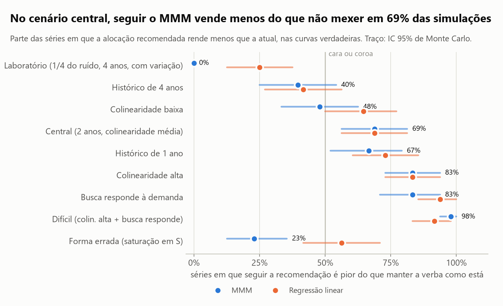
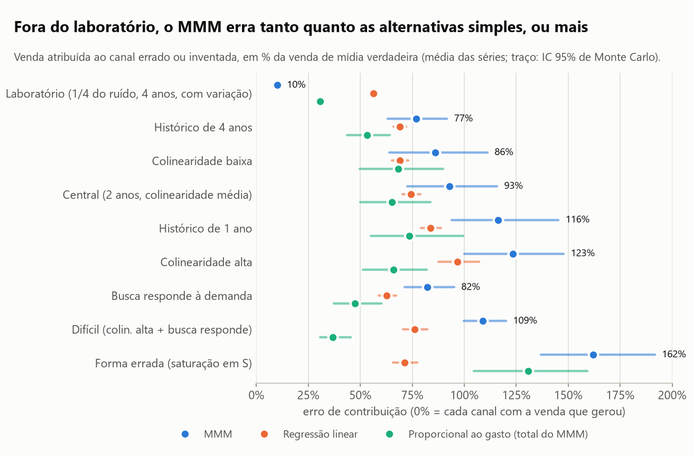
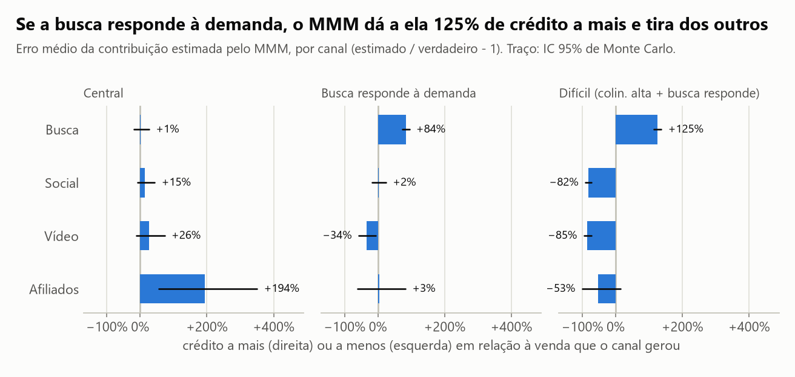
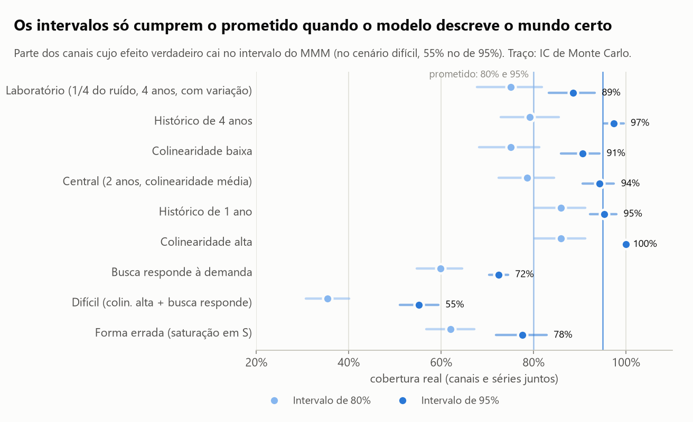
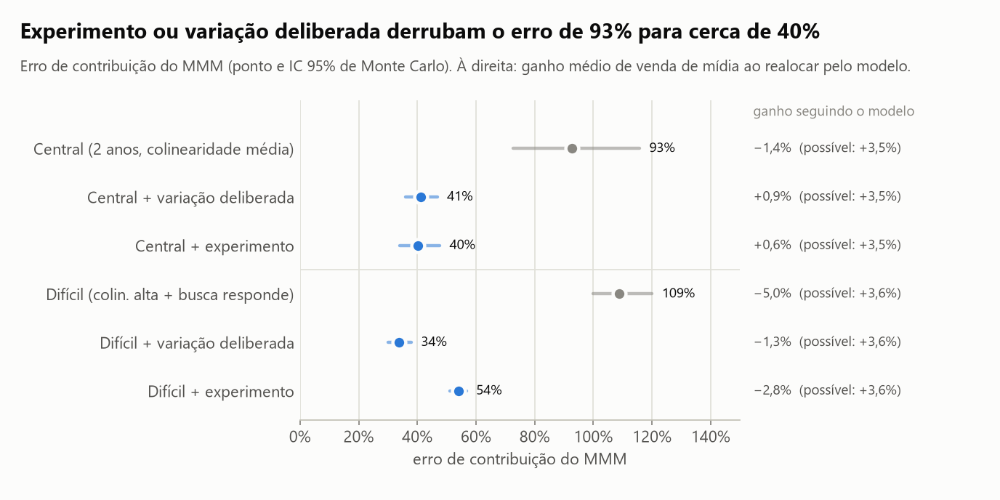
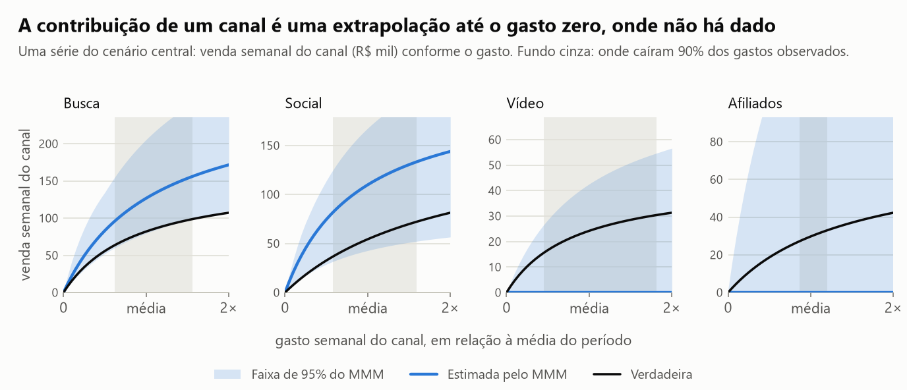

# O modelo de mix de marketing recupera o efeito de cada canal? Em que condições não, e quanto custa realocar a verba com base nele?

**Só em condições de laboratório.** Com dois anos de dados semanais típicos, o modelo atribui ao canal errado (ou
inventa) o equivalente a **93% da venda de mídia** (IC 95% de Monte Carlo: 73% a 116%), empata com uma regressão
linear (74%), e realocar a verba seguindo o que ele recomenda vende menos do que não mexer em **69% das simulações**
(56% a 81%). Com variação deliberada de gasto ou com calibração por experimento, o erro cai para cerca de **40%**.

**Os dados deste estudo são simulados, e isso é o desenho, não um atalho.** Num dado real ninguém sabe quanto cada
canal vendeu de verdade, então não há como medir o erro de um modelo de mix de marketing (MMM). Aqui o efeito de
cada canal é escolhido por um gerador, o modelo é ajustado sem ver o gabarito, e os dois são comparados. Nenhum
número deste README descreve uma operação real: eles descrevem o comportamento do método num mundo com premissas
declaradas (seção "De onde vêm os números do gerador").

## Em 30 segundos

- **A pergunta.** MMM virou a resposta padrão para medir mídia sem cookies. O gestor recebe um gráfico de
  "contribuição por canal" e realoca verba. Quando esse gráfico merece confiança?
- **O método.** 15 cenários, 48 séries semanais em cada um, quatro canais (busca, social, vídeo, afiliados) com
  efeito defasado e retorno decrescente. O MMM, o bootstrap em blocos e a otimização da verba foram implementados em
  NumPy/SciPy, sem bibliotecas de MMM.
- **O modelo funciona quando os dados deixam.** Com quatro anos, gastos independentes, variação deliberada e um
  quarto do ruído, o erro é de 10% e seguir o modelo captura 3,4% dos 3,6% de venda de mídia que havia a ganhar.
- **Com dados típicos, ele empata com o simples.** O MMM não bate a regressão linear em nenhum cenário só com dados
  de histórico, e repartir o total que ele mesmo estima na proporção do gasto erra menos do que a repartição dele.
- **Os intervalos são honestos só no mundo certo.** Cobertura de 94% (prometido: 95%) no cenário central, à custa de
  intervalos três vezes maiores que o efeito. Quando o gasto de busca responde à demanda e os canais andam juntos,
  cai para 55%, e o intervalo da busca nunca contém o valor verdadeiro.
- **O que conserta é variação que o histórico não tem.** Um teste de retirada de verba, visto pelo modelo ou usado
  para calibrá-lo, corta o erro para menos da metade. A decisão de realocar melhora menos do que a medição.

## As figuras



**Da medição à decisão.** A verba do mundo simulado está mal repartida de propósito: com as curvas verdadeiras,
realocar rende 3,5% a mais de venda de mídia. Cada ponto é a parte das 48 séries em que a alocação recomendada pelo
método rende *menos* que a atual. No laboratório o MMM nunca perde. No cenário central perde em 69% das vezes, e a
regressão linear também. No cenário difícil (canais muito correlacionados e busca respondendo à demanda), em 98%.
A exceção é a forma errada: ali o mundo tem curvas em S, há 12,2% a ganhar, e o modelo captura 5,0% mesmo errando
feio a contribuição.



**A medição.** O erro de contribuição soma, canal a canal, a venda atribuída a mais ou a menos, e divide pela venda
de mídia verdadeira. Fora do laboratório o MMM (azul) fica à direita das alternativas. A regressão linear (laranja)
erra de um jeito previsível: subestima todos os canais, porque ignora a saturação. A regra proporcional (verde-água)
usa o total estimado pelo próprio MMM e só troca a repartição entre canais pela proporção do gasto: ela ganhar
significa que a repartição do modelo acrescenta ruído, não informação.



**Para onde vai o crédito.** No cenário central o modelo não tem viés forte em busca, social e vídeo; o canal de
afiliados, cujo gasto quase não varia, recebe em média o triplo do que gerou. Quando o gasto de busca sobe junto com
a demanda (busca de marca), o modelo confunde consequência com causa: a busca recebe 84% a mais. Com os canais muito
correlacionados, 125% a mais, e o crédito sai de social e vídeo.



**A incerteza.** Enquanto o modelo tem a forma do mundo e nenhum gasto responde à demanda, o bootstrap em blocos
entrega perto do que promete (91% a 100% para o intervalo de 95%; 89% no laboratório, onde a penalidade pesa mais
do que o ruído). O intervalo falha justamente nos dois casos que o analista não consegue ver nos dados: gasto que
responde à demanda (72%; 55% no cenário difícil) e forma errada (78%).



**O conserto.** "Variação deliberada" é um teste de retirada de verba dentro do histórico: cada canal fica seis
semanas com 10% do gasto e seis com 180%, em períodos separados. "Experimento" é o resultado de um teste de retirada
(o efeito total do canal, medido com erro-padrão de 20%) em busca e afiliados, usado como penalidade no ajuste. As
duas coisas cortam o erro de 93% para cerca de 40% no cenário central. No cenário difícil o experimento conserta os
canais testados, mas a realocação continua perdendo (−2,8%): o experimento mede o efeito total da busca, e a decisão
depende da inclinação da curva, que continua contaminada pela demanda.



**Por que é difícil.** Uma série do cenário central (a que está em `data/`). Os dados só informam a curva na faixa
de gasto observada (fundo cinza). A contribuição do canal é a altura da curva medida desde o gasto zero, onde não há
observação: depende da curvatura, que os dados quase não informam. Em afiliados, cujo gasto quase não varia, a faixa
de 95% cobre de zero a várias vezes o valor verdadeiro.

## Como foi feito

1. **Gerador** (`src/mmm_confiar/dados.py`). Vendas semanais = base (tendência e sazonalidade) + promoção + quatro
   canais + choque de demanda persistente + ruído. Cada canal: adstock geométrico (pesos somando 1) e saturação de
   Hill. A verba toda sobe na alta temporada (colinearidade), afiliados quase não varia, e num cenário o gasto de
   busca responde ao choque de demanda. A mesma semente dá o mesmo mundo e o mesmo ruído em todos os cenários.
2. **MMM** (`modelo.py`). Máxima verossimilhança penalizada com restrições: efeitos não negativos, retenção entre 0
   e 0,9, meia saturação entre 0,2 e 5 vezes o gasto médio, e penalidade genérica na forma da curva (o papel das
   distribuições a priori). Ajuste por Levenberg-Marquardt com conjunto ativo, oito pontos de partida, vetorizado.
3. **Incerteza.** Bootstrap em blocos circulares dos resíduos (6 a 9 semanas por bloco), 200 réplicas por série,
   resíduos inflados pelos graus de liberdade, intervalos percentis.
4. **Linhas de base** (`linha_de_base.py`). Regressão linear das vendas no gasto da semana, com a mesma linha de
   base e o mesmo bootstrap; e atribuição proporcional ao gasto.
5. **Decisão** (`otimizacao.py`). Alocação que maximiza a venda prevista com a verba total fixa e cada canal entre
   50% e 150% do gasto atual (SLSQP), avaliada nas curvas verdadeiras.
6. **Estudo de recuperação** (`recuperacao.py`, `analise.py`). Cada métrica é a média de 48 séries, com intervalo
   de 95% de Monte Carlo (bootstrap das sementes). Comparações entre cenários são feitas semente a semente.

O modelo ajustado tem a mesma forma do gerador em todos os cenários menos um: é o melhor caso possível para o MMM.
No cenário "forma errada" o gerador usa saturação em S (Hill com expoente 2) e efeito com pico atrasado em social e
vídeo; o erro de contribuição sobe 69 pontos (57 a 82) e a cobertura cai 17 pontos.

### De onde vêm os números do gerador

| Grandeza | Valor | Origem |
|---|---|---|
| Retenção do adstock | busca 0,15; social 0,30; vídeo 0,60; afiliados 0,10 (±0,08 por série) | Faixas sugeridas na documentação do Robyn para o adstock geométrico: digital de 0 a 0,3, TV de 0,3 a 0,8 |
| Forma da saturação e do adstock atrasado | Hill; pesos proporcionais a retenção^((k − pico)²) | Jin et al. (2017) |
| Meia saturação | 0,6 a 1,5 vez o gasto médio (variação de ±25% por série) | Premissa. O Robyn sugere o ponto de inflexão entre 30% e 100% da faixa de gasto |
| ROI no gasto médio | busca 2,4; social 2,0; vídeo 0,9; afiliados 3,2 (±15%) | Premissa |
| Ruído semanal | 3% da venda base (choque persistente de 2,4% e ruído de 1,8%); cerca de 2% da venda total | Premissa |
| Mídia nas vendas | cerca de 17% das vendas; gasto de cerca de 9% das vendas | Consequência das premissas acima |
| Erro do experimento | erro-padrão de 20% do efeito | Premissa |
| Penalidade no ROI (sensibilidade) | log ROI com centro 0,2 e largura 0,9 | Distribuição a priori padrão do Meridian para o ROI |

Referências: Jin, Wang, Sun, Chan e Koehler (2017), *Bayesian Methods for Media Mix Modeling with Carryover and
Shape Effects*; Chan e Perry (2017), *Challenges and Opportunities in Media Mix Modeling*; Chen et al. (2018), *Bias
Correction For Paid Search In Media Mix Modeling* (arXiv:1807.03292); Zhang e Vaver (2017), *Introduction to the
Aggregate Marketing System Simulator* (a ideia de avaliar MMM em mundo simulado com gabarito); documentação do
[Robyn](https://facebookexperimental.github.io/Robyn/) e do
[Meridian](https://developers.google.com/meridian/docs/advanced-modeling/default-prior-distributions).

## Comparação com a alternativa simples

Erro de contribuição (menor é melhor), parte dos pares de canais ordenados ao contrário pelo ROI (50% = cara ou
coroa) e ganho de venda de mídia ao realocar. "Proporcional" reparte o total estimado pelo MMM na proporção do gasto.

| Cenário | Erro: MMM | Erro: linear | Erro: proporcional | MMM − linear (IC 95%) | Pares invertidos: MMM / linear | Ganho: MMM / linear / possível |
|---|---|---|---|---|---|---|
| Laboratório | 10% | 56% | 31% | −48 a −45 | 5% / 10% | +3,4% / +1,8% / +3,6% |
| Histórico de 4 anos | 77% | 69% | 53% | −5 a +22 | 34% / 24% | +0,2% / −0,1% / +3,6% |
| Colinearidade baixa | 86% | 69% | 68% | −4 a +41 | 32% / 28% | −0,1% / −0,8% / +3,5% |
| **Central** (2 anos, colinearidade média) | 93% | 74% | 65% | −1 a +40 | 39% / 30% | −1,4% / −1,3% / +3,5% |
| Histórico de 1 ano | 116% | 84% | 74% | +10 a +63 | 43% / 41% | −2,2% / −2,8% / +3,5% |
| Colinearidade alta | 123% | 97% | 66% | +7 a +48 | 46% / 29% | −3,9% / −2,9% / +3,6% |
| Busca responde à demanda | 82% | 63% | 47% | +8 a +33 | 42% / 38% | −2,8% / −3,3% / +3,6% |
| Difícil (colinearidade alta + busca responde) | 109% | 76% | 37% | +22 a +45 | 46% / 38% | −5,0% / −4,1% / +3,6% |
| Forma errada | 162% | 71% | 131% | +66 a +119 | 39% / 29% | +5,0% / −0,9% / +12,2% |
| Central + variação deliberada | 41% | 60% | 37% | −24 a −13 | 28% / 24% | +0,9% / −1,0% / +3,5% |
| Central + experimento | 40% | 74% | 38% | −42 a −25 | 20% / 30% | +0,6% / −1,3% / +3,5% |
| Difícil + variação deliberada | 34% | 53% | 32% | −24 a −15 | 21% / 22% | −1,3% / −2,2% / +3,6% |
| Difícil + experimento | 54% | 76% | 36% | −28 a −17 | 19% / 38% | −2,8% / −4,1% / +3,6% |
| Central + penalidade no ROI | 46% | 74% | 40% | −35 a −22 | 46% / 30% | −1,0% / −1,3% / +3,5% |
| Central com metade do ruído | 55% | 66% | 44% | −22 a +1 | 32% / 22% | +0,8% / +0,3% / +3,5% |

**A linha de base empata ou ganha em todos os cenários só com dados de histórico.** No central, em 4 anos e em
colinearidade baixa o intervalo da diferença inclui o zero (empate); em 1 ano, colinearidade alta, busca que responde
à demanda, difícil e forma errada a regressão linear erra menos, na média. Na ordem dos canais a regressão linear também é
igual ou melhor (no central, o MMM inverte 9 pontos a mais de pares; IC 3 a 16). No ganho da realocação os dois
empatam no central (diferença de −0,1 ponto; IC −1,0 a +0,9). O MMM só vence com clareza no laboratório, com
variação deliberada ou com experimento. E a regra proporcional, que não distingue canal nenhum, erra menos que o MMM
em todos os cenários observacionais: diferença de 28 pontos no central (IC 19 a 36).

Cobertura real do intervalo de 95%: MMM 94% no central, 100% em colinearidade alta, 72% com busca respondendo à
demanda, 55% no difícil, 78% na forma errada; a regressão linear cobre 37% no central, porque o viés dela (ignorar a
saturação) não cabe no intervalo.

## Onde este estudo falha

- **O mundo é o meu.** As conclusões valem para as premissas da tabela acima. A mais forte é o ruído de 3% com a
  mídia respondendo por cerca de 17% das vendas: com metade do ruído o erro do MMM cai de 93% para 55% e ele passa a
  empatar com a regressão linear em vez de tender a perder. Um anunciante em que a mídia paga é metade da venda, ou
  com dados diários ou por região, está em outro regime, que este estudo não mede.
- **Um estimador só.** O MMM aqui é verossimilhança penalizada com penalidade na forma da curva e estimativa
  pontual. Um MMM bayesiano completo resume a incerteza pela média a posteriori e costuma pôr distribuição a priori
  no ROI. A sensibilidade "penalidade no ROI" dá uma ideia: o erro cai para 46%, mas porque todos os canais são
  puxados para o mesmo ROI; a ordem dos canais fica em cara ou coroa (46% de pares invertidos) e a cobertura cai para
  72%. Não testei Robyn, Meridian nem PyMC-Marketing: o estudo não autoriza dizer que eles falham do mesmo jeito.
- **Melhor caso na forma.** Em 14 dos 15 cenários o modelo tem exatamente a forma do gerador, e a linha de base do
  modelo (tendência, sazonalidade, promoção) também. Há só um cenário de especificação errada, com uma forma
  alternativa; outras formas podem piorar mais ou menos.
- **O erro médio é puxado por estouros.** A distribuição do erro do MMM tem cauda longa (a mediana no central é
  71%, a média 93%), quase toda em afiliados, o canal sem variação de gasto. Pela mediana das diferenças, MMM e
  regressão linear empatam também onde a média favorece a linear. Um analista que descartasse canais com
  intervalo absurdo teria erro médio menor. O intervalo de Monte Carlo do erro do MMM é largo (±21 pontos no central).
- **48 séries por cenário.** O erro de Monte Carlo da frequência "pior que não mexer" é de ±13 pontos. Diferenças
  menores que isso entre cenários não são conclusão; as comparações do texto usam as diferenças semente a semente.
- **O experimento é idealizado.** Ele mede o efeito total do canal sem viés, com erro conhecido. Experimento real
  mede uma variação parcial de gasto, numa parte das regiões, num período; a tradução para o modelo tem erro próprio.
- **A decisão é de um período.** A realocação é avaliada em regime estacionário (gasto semanal constante), com limite
  de ±50% por canal e sem custo de mudança. A verba do mundo de referência foi desenhada com 3,5% a ganhar; com uma
  verba já perto do ótimo, qualquer modelo com erro só pode piorar.
- **O bootstrap parte da estimativa.** Cada réplica é reajustada a partir do ótimo encontrado, não de vários pontos
  de partida; se houver mínimos locais relevantes, o intervalo os ignora (no ajuste principal, 93% a 100% dos pontos
  de partida chegam ao mesmo ótimo).

## Como rodar

Pré-requisito: [`uv`](https://docs.astral.sh/uv/getting-started/installation/).

```bash
uv sync
uv run python scripts/gerar_dados.py     # grava o conjunto de exemplo e o gabarito em data/
uv run python scripts/rodar_analise.py   # regera reports/resultados.json e as figuras (2,5 a 5 minutos conforme a carga da máquina)
uv run pytest                            # 47 testes
```

Não há base para baixar. O notebook [`analise.ipynb`](analise.ipynb) conta a história com as tabelas; ele é montado
por `scripts/montar_notebook.py` e lê `reports/resultados.json`.

Estrutura: `src/mmm_confiar/` (`transformacoes.py`, `dados.py`, `modelo.py`, `linha_de_base.py`, `otimizacao.py`,
`recuperacao.py`, `analise.py`, `graficos.py`, `site.py`, `estilo.py`), `scripts/`, `tests/`, `reports/`, `data/`.

## Como este estudo foi feito

Este estudo foi construído com assistência de IA (Claude Code, da Anthropic), usada como par de programação.
Declaro a divisão do trabalho porque ela importa para quem avalia:

- **Meu:** a direção (quais frentes da ciência de dados estudar e por quê), o contexto de negócio que dá sentido à
  pergunta, vindo de onze anos de marketing digital (tráfego pago desde 2021, automação desde 2018), a leitura
  crítica dos resultados e a decisão do que publicar e do que declarar como limitação.
- **Com o assistente:** a formulação da pergunta a partir desse contexto, a escolha da base pública e do método, a
  implementação do código, dos testes e dos gráficos, e a redação, que revisei.
- **Como conferir:** todo número deste README sai de `reports/resultados.json`, gerado por
  `scripts/rodar_analise.py`. Os testes em `tests/` conferem as funções de método contra casos de resposta
  conhecida.

É o mesmo jeito que trabalho nos sistemas que entrego: a IA acelera a implementação, e a responsabilidade pelo que
está escrito aqui é minha.

## Summary (English)

A recovery study of marketing mix models (MMM) on simulated weekly data, where the true effect of each channel is
known by construction. An MMM with geometric adstock and Hill saturation was implemented from scratch in NumPy/SciPy
(penalized likelihood, non-negativity constraints, batched Levenberg-Marquardt with multiple starts, circular block
bootstrap) and run on 15 scenarios with 48 series each, varying collinearity, history length, a channel whose spend
reacts to demand, deliberate spend variation, experiment calibration and a misspecified functional form. Under lab
conditions the model recovers channel contributions (10% error) and its budget reallocation captures 3.4 of the 3.6%
available. With two years of typical observational data it misattributes 93% of media-driven sales (95% Monte Carlo
CI 73 to 116%), is no better than a plain linear regression (74%), and following its reallocation is worse than
leaving the budget alone in 69% of simulations. Its 95% intervals cover 94% when the model is right but 55% when
search spend follows demand and channels are collinear. Deliberate spend variation or calibration with an experiment
cuts the error to about 40%. Limits: one simulated world with stated assumptions, one estimator, no comparison with
Robyn, Meridian or PyMC-Marketing. Code, notebook and README are in Portuguese.

---

Hélcio Venâncio · [github.com/ghitflux](https://github.com/ghitflux) · Licença MIT
